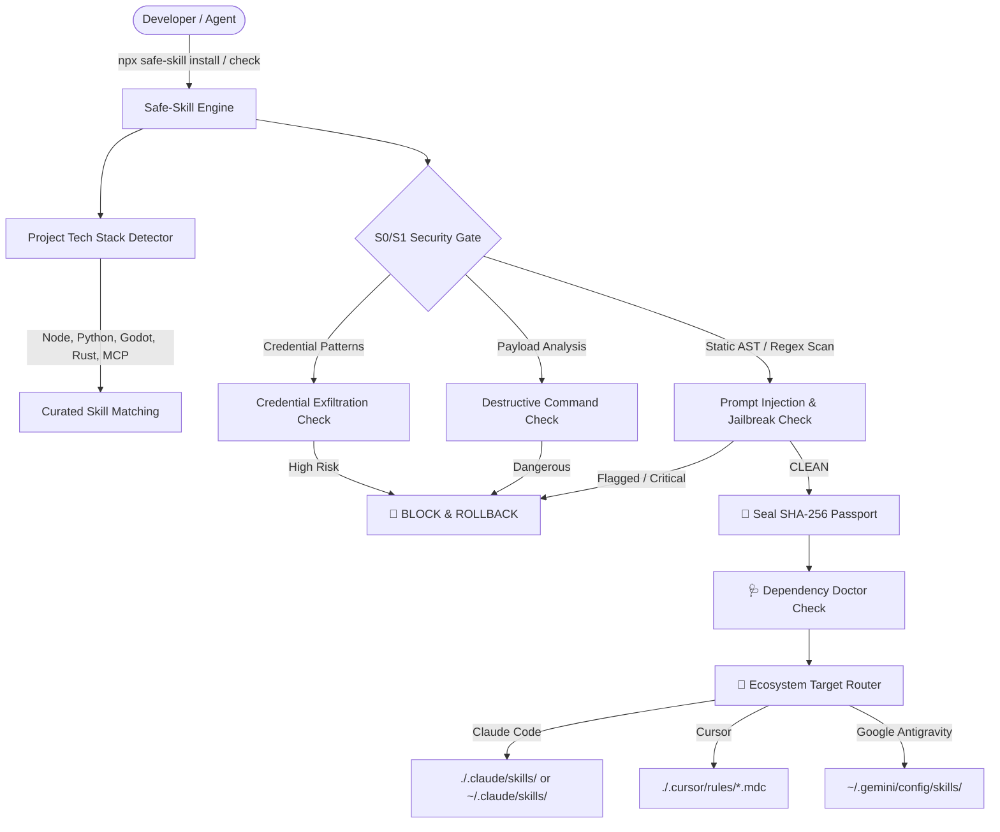

<div align="center">

# 🛡️ Safe-Skill

**The Security-First Multi-Agent Skill Manager for Claude Code, Cursor, Windsurf & Google Antigravity.**<br>
Zero-trust skill discovery, S0/S1 prompt injection defense, SHA-256 integrity sealing, and cross-ecosystem installation.

[](LICENSE)
[]()
[]()
[]()
[]()
[]()

[**English**](README.md) · [**Türkçe Dokümantasyon**](README.tr.md)

</div>

---

## ⚡ The Problem

Community skills repositories (like `skills.sh` or standard CLI tools) download and execute arbitrary prompt instructions and scripts directly on your local developer machine. **Most managers offer zero security scanning**:
* 🔴 An unverified skill can contain **prompt injections** (`ignore previous instructions`, `dan mode`).
* 🔴 A skill can attempt to **exfiltrate API keys** (`~/.ssh`, `~/.aws/credentials`).
* 🔴 A skill can execute **destructive system calls** (`rm -rf /`, `curl ... | sh`, `Format-Volume`).
* 🔴 Upstream repositories can be **tampered with or silently updated** (TOCTOU attacks).

---

## 🛡️ The Solution: Safe-Skill Architecture



---

## 🚀 Quick Start

Run instantly without global installation via `npx`:

```bash
# Launch interactive TUI menu
npx safe-skill

# Analyze current project tech stack and get tailored skill recommendations
npx safe-skill

# Search official Anthropic & community skills
npx safe-skill search frontend

# Install with automatic target detection & S0/S1 security gate
npx safe-skill install safe-git

# Install specifically for Claude Code or Cursor
npx safe-skill install frontend-design --target claude
npx safe-skill install mcp-builder --target cursor

# Check update status & integrity of all installed skills
npx safe-skill check

# Update a skill with upstream security gate verification
npx safe-skill update frontend-design

# Verify system binaries & tool dependencies
npx safe-skill doctor
```

---

## ⚔️ Comparison: Safe-Skill vs. Standard Tools

| Feature | Standard `find-skills` (`skills.sh`) | **Safe-Skill** 🛡️ |
| :--- | :--- | :--- |
| **S0/S1 Security Gate** | ❌ None (Text disclaimer only) | ✅ **Automated Static AST / Regex Engine** |
| **Prompt Injection Defense** | ❌ None | ✅ **Detects Jailbreaks & System Overrides** |
| **Cryptographic Integrity** | ❌ None | ✅ **SHA-256 `passport.json` Sealing** |
| **Tamper Detection (TOCTOU)** | ❌ None | ✅ **Alerts if local files are altered** |
| **Target Ecosystems** | `.claude` only | ✅ **Claude Code, Cursor (.mdc), Antigravity** |
| **Project Stack Auto-Detection** | ❌ None | ✅ **Node, Python, Godot, Rust, Android, MCP** |
| **Prior-Art Search** | ❌ None | ✅ **19 Registries via Patent CLI** |
| **Interactive TUI** | ❌ None | ✅ **Zero-Dependency Terminal Menu** |
| **Upstream Update Protection** | ❌ None | ✅ **Blocks updates if upstream turns malicious** |

---

## 📦 Key Commands

### 1. `scan [target]` — Security & Prompt Injection Audit
Audits any local skill folder or repository before running it:
```bash
npx safe-skill scan ./path/to/skill
```

### 2. `check` & `update` — Safe Upstream Synchronization
Checks whether upstream repositories have released updates and verifies that the new version is clean:
```bash
# Check all installed skills
npx safe-skill check

# Check specifically for Claude Code skills
npx safe-skill check --target claude

# Apply update with security gate
npx safe-skill update frontend-design
```

### 3. `doctor` — Tool & Runtime Dependency Check
Verifies that all binaries required by installed skills (`python`, `node`, `git`, `gh`, `patent`, `ffmpeg`, `yt-dlp`, `deno`) are installed with correct versions:
```bash
npx safe-skill doctor
```

---

## 🛠️ Development & Testing

```bash
git clone https://github.com/halilogia/safe-skill.git
cd safe-skill
npm test
```

## 📄 License
MIT © 2026 Halil Emre
