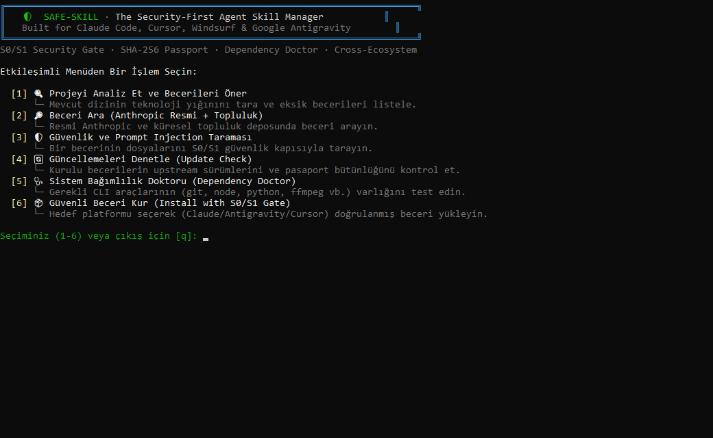
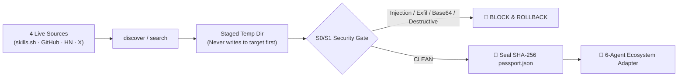

<div align="center">

# 🛡️ Safe-Skill

**Security-First Multi-Agent Skill Manager & Autonomous Workflow Radar**<br>
Discover unknown AI workflows across the open web, scan every byte through an S0/S1 security gate, seal with SHA-256 passports, and route to 6 coding-agent ecosystems — with **zero runtime dependencies**.

[](https://github.com/halilogia/safe-skill/actions/workflows/test.yml)
[](https://nodejs.org)
[](package.json)
[-8b5cf6)](src/mcp_server.ts)
[](LICENSE)

[**Overview**](#-why-safe-skill) · [**Workflow Radar**](#-autonomous-workflow-radar-discover) · [**Architecture**](#%EF%B8%8F-architecture--security-gate) · [**Quick Start**](#-quick-start) · [**Ecosystems**](#-6-agent-ecosystem-routing) · [**MCP Server**](#-mcp-server-integration) · [**Türkçe**](README.tr.md)

<br>



</div>

---

## ⚡ Why Safe-Skill?

Modern AI coding agents (`Claude Code`, `Cursor`, `Windsurf`, `Copilot`, `Codex`, `Antigravity`) rely on external `SKILL.md` playbooks and MCP workflows. Two critical gaps exist today:

| 1. Discovery Blindness | 2. Supply-Chain Risk |
| :--- | :--- |
| Breakthrough workflows (procedural 3D, pixel VFX, game audio, shaders) are scattered across X threads, unindexed GitHub `SKILL.md` commits, and `Show HN` posts. | Standard managers copy remote markdown and scripts straight to disk with **zero inspection** — exposing machines to prompt injections, `curl \| sh` backdoors, and silent TOCTOU tampering. |

**Safe-Skill solves both in one deterministic, zero-dependency CLI & MCP server.**

---

## 🧭 Autonomous Workflow Radar (`discover`)

Instead of manually browsing X or scanning thousands of GitHub repos, `discover` fans out across **4 live high-signal sources** in parallel, deduplicates spam forks, and ranks results by agent-readiness:

- **`skills.sh` Registry** — packaged agent skills (`owner/repo@skill`)
- **GitHub `SKILL.md` Code Index** — newly published skills not yet in registries
- **GitHub High-Signal Repos** — procedural pipelines, CLI tools, and MCP servers
- **Hacker News `Show HN`** — builder-shared AI & creative workflows

| Domain Preset | Command | Discovers |
| :--- | :--- | :--- |
| **`3d`** | `npx safe-skill discover --domain 3d` | Procedural 3D, Blender MCP, foliage, glTF/GLB generators |
| **`pixel-vfx`** | `npx safe-skill discover --domain pixel-vfx` | `pixelfx`, sprite sheet generators, procedural pixel art |
| **`audio-sfx`** | `npx safe-skill discover --domain audio-sfx` | `sfxr`, procedural game audio, ElevenLabs SFX skills |
| **`shader`** | `npx safe-skill discover --domain shader` | Godot shaders, GLSL VFX, SDF & procedural shaders |
| **`gamedev`** | `npx safe-skill discover --domain gamedev` | Godot MCP, game asset pipelines, engine tooling |
| **`video`** | `npx safe-skill discover --domain video` | FFmpeg pipelines, Remotion, AI video workflows |

---

## 🛡️ Architecture & Security Gate



- **S0 Content Defense:** Detects prompt injections, jailbreaks, hidden HTML comments, zero-width/bidi Unicode (`Trojan Source`), and Latin/Cyrillic homoglyphs.
- **S1 Action Defense:** Blocks `curl | sh`, PowerShell `IEX`, reverse shells, credential exfiltration (`~/.ssh`, `~/.aws`), Base64 obfuscated payloads, and MCP config poisoning (`mcp_config.json`).
- **Real Community Install:** `install owner/repo@skill` or `install <github-or-x-url>` fetches the authentic `SKILL.md` (or synthesizes one from `README.md` / X post) and stages it through the gate before touching your workspace.

---

## 🚀 Quick Start

Requires **Node.js `>= 22.6.0`** (uses native `--experimental-strip-types` — no build step, no `node_modules`).

```bash
# Discover unknown workflows by topic or domain preset
npx safe-skill discover "pixel vfx"
npx safe-skill discover --domain 3d

# Preview & security-scan a remote skill or GitHub repo before installing
npx safe-skill install bgrenat/godot-game-dev-studio --dry-run

# Install official Anthropic, community (owner/repo@skill), or X/GitHub workflows
npx safe-skill install frontend-design --target claude
npx safe-skill install vladmdgolam/agent-skills@blender-mcp --target antigravity

# Scan any local skill directory & verify SHA-256 integrity
npx safe-skill scan ./path/to/skill
npx safe-skill check
npx safe-skill doctor
```

---

## 🎯 6-Agent Ecosystem Routing

| Ecosystem | Flag | Workspace Target | Format |
| :--- | :--- | :--- | :--- |
| **Google Antigravity** | `--target antigravity` | `.gemini/skills/<name>/SKILL.md` | `SKILL.md` |
| **Claude Code** | `--target claude` | `.claude/skills/<name>/SKILL.md` | `SKILL.md` |
| **Cursor** | `--target cursor` | `.cursor/rules/<name>.mdc` | `.mdc` frontmatter |
| **Windsurf** | `--target windsurf` | `.windsurf/rules/<name>.md` | Markdown rule |
| **GitHub Copilot** | `--target copilot` | `.github/instructions/<name>.instructions.md` | `applyTo: "**"` |
| **OpenAI Codex** | `--target codex` | `.codex/skills/<name>/SKILL.md` | `SKILL.md` |

---

## 🔌 MCP Server Integration

Expose Safe-Skill's **9 native tools** (`discover_workflows`, `scan_skill`, `install_safe_skill`, `search_skills`, `match_intent`, `verify_passport`, `diagnose_dependencies`, `check_updates`, `check_advisories`) over STDIO JSON-RPC 2.0:

```json
{
  "mcpServers": {
    "safe-skill": {
      "command": "npx",
      "args": ["-y", "safe-skill", "mcp"]
    }
  }
}
```

---

## 🛠️ Development & Docs

```bash
git clone https://github.com/halilogia/safe-skill.git
cd safe-skill
npm test
```

[Architecture](ARCHITECTURE.md) · [Roadmap](ROADMAP.md) · [Changelog](CHANGELOG.md) · [Knowledge](KNOWLEDGE.md) · [Tasks](TASKS.md) · [Agents](AGENTS.md) · [Design](DESIGN.md) · [MIT License](LICENSE)
