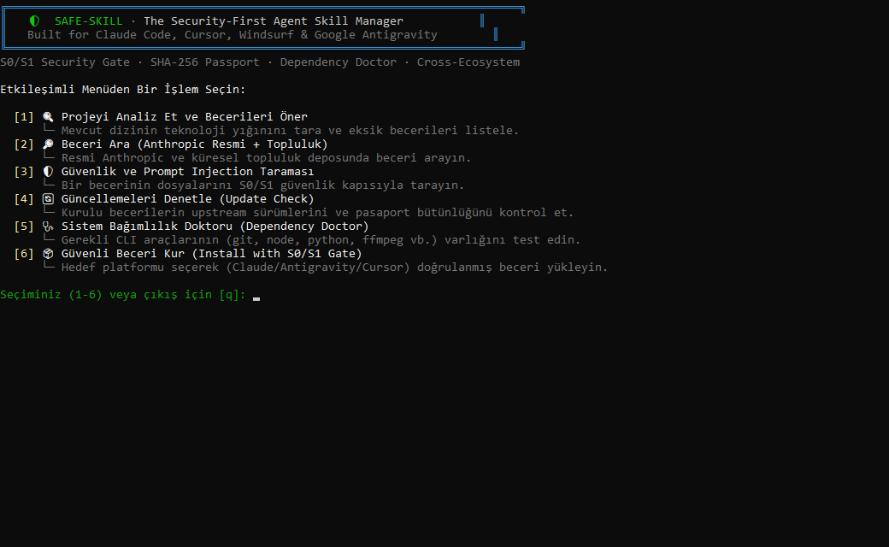

<div align="center">

# 🛡️ Safe-Skill (Türkçe Kılavuz)

**Güvenlik Öncelikli Çoklu Ajan Beceri Yöneticisi & Otonom İş Akışı Radarı**<br>
İnternetteki bilinmeyen iş akışlarını keşfedin, S0/S1 güvenlik kapısından geçirin, SHA-256 pasaportuyla mühürleyin ve 6 farklı kodlama ajanına sıfır bağımlılıkla kurun.

[](https://github.com/halilogia/safe-skill/actions/workflows/test.yml)
[](https://nodejs.org)
[](package.json)
[](LICENSE)

[**English**](README.md) · [**Türkçe**](README.tr.md)

<br>



</div>

---

## ⚡ Neden Safe-Skill?

1. **Keşif Körlüğünü Çözer:** Prosedürel 3D, piksel VFX, oyun sesi veya shader gibi harika iş akışları X gönderilerine, GitHub repolarına ve Hacker News paylaşımlarına dağılmış durumdadır. `discover` komutu 4 canlı kaynağı paralel tarayıp size hazır getirir.
2. **Tedarik Zinciri Güvenliği Sağlar:** Standart araçlar internetteki markdown ve betikleri doğrudan diske kopyalar. Safe-Skill ise her şeyi önce geçici dizinde **S0/S1 Güvenlik Kapısı**'ndan geçirir, zararlı komutları engeller ve temiz dosyaları **SHA-256 `passport.json`** ile mühürler.

---

## 🧭 Otonom İş Akışı Radarı (`discover`)

```bash
# Konu veya hazır alan ile internetteki iş akışlarını keşfet:
npx safe-skill discover "pixel vfx"
npx safe-skill discover --domain 3d
# Alanlar: 3d | pixel-vfx | audio-sfx | shader | gamedev | video

# Kurmadan önce gerçek içeriği ve S0/S1 taramasını önizle:
npx safe-skill install bgrenat/godot-game-dev-studio --dry-run

# Topluluk becerisini, GitHub reposunu veya X gönderisini kur:
npx safe-skill install vladmdgolam/agent-skills@blender-mcp --target antigravity
```

---

## 🎯 6 Ajan Ekosistemi Desteği

- **Google Antigravity:** `.gemini/skills/<ad>/SKILL.md`
- **Claude Code:** `.claude/skills/<ad>/SKILL.md`
- **Cursor:** `.cursor/rules/<ad>.mdc`
- **Windsurf:** `.windsurf/rules/<ad>.md`
- **GitHub Copilot:** `.github/instructions/<ad>.instructions.md`
- **OpenAI Codex:** `.codex/skills/<ad>/SKILL.md`

---

## 📄 Lisans
MIT © 2026 Halil Emre
